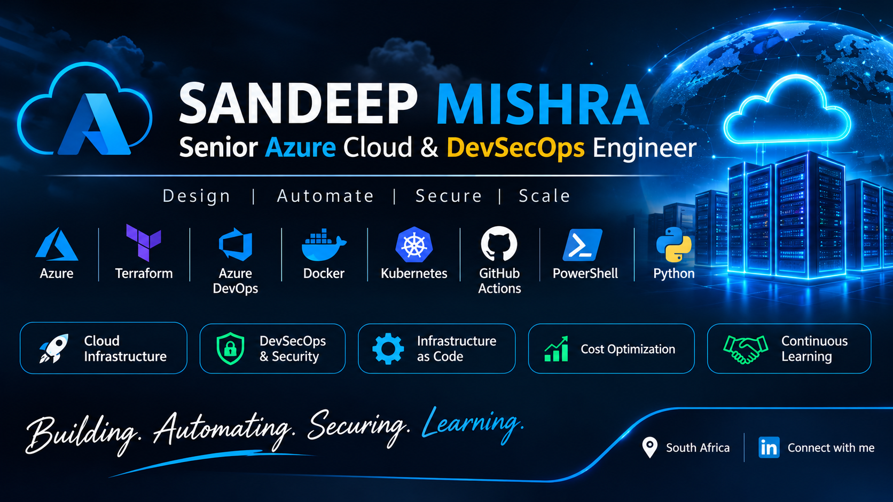

  

---

# Hi, I'm Sandeep Mishra 👋

### Senior Azure Cloud & DevSecOps Engineer | Cloud Infrastructure | Infrastructure as Code | Automation

I am an IT professional with **9+ years of experience**, specializing in Microsoft Azure, Cloud Infrastructure, DevOps, and DevSecOps.

I enjoy designing, automating, securing, and optimizing cloud infrastructure using modern technologies and Infrastructure as Code (IaC).

Currently focused on building reusable Terraform modules, Azure infrastructure solutions, CI/CD automation, and secure cloud deployment architectures.

---

### 🚀 Technical Skills

**Cloud Platforms**
- Microsoft Azure
- AWS (Fundamentals)

**Infrastructure as Code**
- Terraform
- Terraform Modules
- Terratest
- TFLint

**DevOps & CI/CD**
- Azure DevOps
- GitHub Actions
- YAML Pipelines
- CI/CD Automation

**Containers & Orchestration**
- Docker
- Kubernetes
- Azure Kubernetes Service (AKS)

**Scripting & Automation**
- PowerShell
- Bash
- Python

**DevSecOps & Security**
- Checkov
- tfsec
- TruffleHog
- SAST / DAST
- Azure Security & Governance
- Microsoft Entra ID
- Conditional Access

**Monitoring & Cost Optimization**
- Azure Monitor
- Prometheus
- Grafana
- OpenCost
- Cloud Cost Optimization

---

### 🛠️ Featured Projects

🔹 **Azure Enterprise Terraform Modules**
- Developing reusable and scalable Azure Terraform modules.
- Implementing modular infrastructure architecture.
- Following Infrastructure as Code best practices.

🔹 **Azure Infrastructure Automation**
- Building Azure infrastructure using Terraform.
- Automating deployments through Azure DevOps pipelines.
- Integrating infrastructure security scanning and validation.

🔹 **Azure 3-Tier Application Deployment**
- Developing and deploying a 3-tier application architecture on Azure.
- Working with frontend, backend, and PostgreSQL database components.
- Implementing application connectivity and cloud infrastructure.

🔹 **DevSecOps CI/CD Pipelines**
- Integrating security tools into CI/CD workflows.
- Automating Terraform validation and security checks.
- Exploring secure deployment practices.

---

### 📚 Currently Learning & Exploring

- Advanced Azure Architecture
- Enterprise Terraform Design Patterns
- Azure DevOps & GitHub Actions
- DevSecOps Automation
- Kubernetes & Container Security
- Cloud Security Best Practices

---

### 💻 Technologies & Tools

---

### 📊 GitHub Statistics

---

<picture>
  <source media="(prefers-color-scheme: dark)" srcset="https://raw.githubusercontent.com/sandeep1991mishra-sys/sandeep1991mishra-sys/output/github-contribution-grid-snake-dark.svg">
  <source media="(prefers-color-scheme: light)" srcset="https://raw.githubusercontent.com/sandeep1991mishra-sys/sandeep1991mishra-sys/output/github-contribution-grid-snake.svg">
  
</picture>

### 🤝 Let's Connect

I'm always interested in connecting with cloud engineers, DevOps professionals, and technology enthusiasts.

- 💼 LinkedIn: [Connect with me](www.linkedin.com/in/sandeepmishra1991)
- 💻 GitHub: [Explore my repositories](https://github.com/sandeep1991mishra-sys)
- 📍 Location: South Africa

---

  
  

  

⭐ Feel free to explore my repositories and follow my journey in Cloud, DevOps, and DevSecOps engineering.

**Building. Automating. Securing. Learning.**
